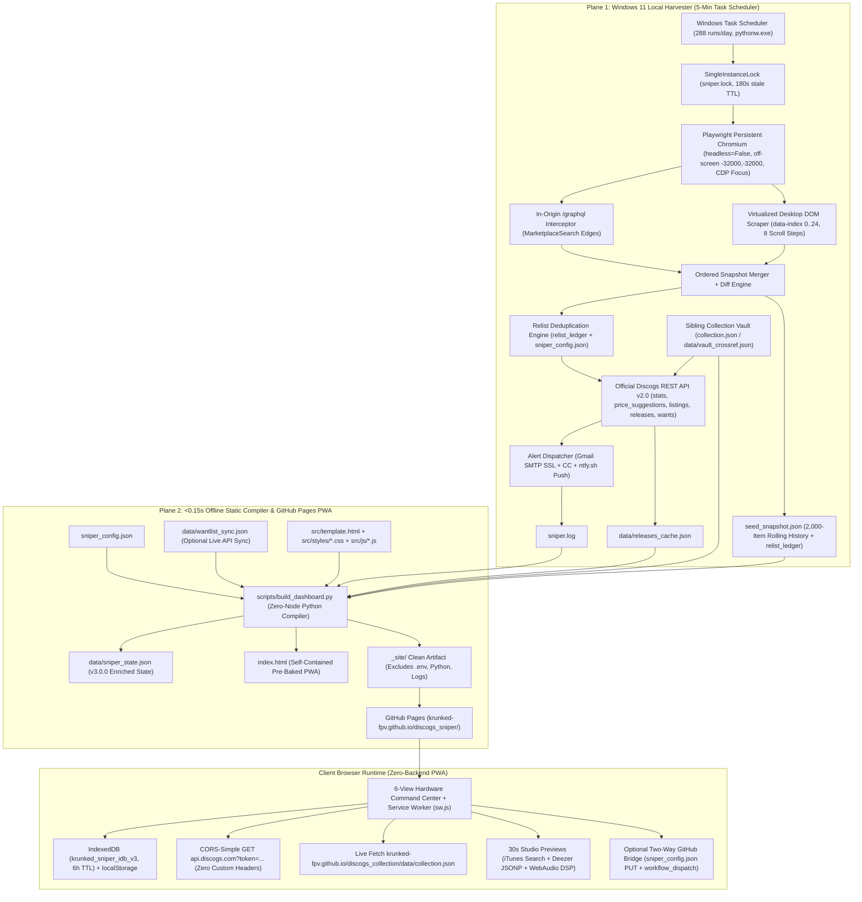

# Architecture — Discogs Sniper (`krunked-fpv/discogs_sniper`)

> **Live Command Center:** `https://krunked-fpv.github.io/discogs_sniper/`
> **Sibling Collection Vault:** `https://krunked-fpv.github.io/discogs_collection/` (`krunked-fpv/discogs_collection`)
> **Local Workstation Root:** `C:\discogs_sniper`

---

## 1. Dual-Plane System Topology

**Discogs Sniper** operates across two strictly decoupled planes so live Marketplace monitoring never depends on a hosted backend, and the public GitHub Pages PWA never exposes local runtime secrets or Playwright state:

1. **Plane 1 — Local Automated Harvester & Alerting Engine (Windows 11):**
   - Executed every **5 minutes** (`288 runs/day`) via Windows Task Scheduler (`setup_task.ps1` launching windowless `pythonw.exe` on `discogs_sniper.py`, `MultipleInstances IgnoreNew`, 3-minute timeout) or foreground `run_sniper.ps1` / `python discogs_sniper.py --daemon`.
   - Enforces `SingleInstanceLock` (`sniper.lock`, 180s stale eviction) before opening the persistent Chromium profile (`chrome_discogs_profile/`).
   - Runs a **Dual-Engine Harvester**: passively intercepts in-origin `/graphql` (`MarketplaceSearch`) JSON responses while scrolling and parsing the virtualized desktop DOM (`div[data-test="desktop-layout"] div[data-index]`).
   - Applies semantic auto-relist deduplication (*"The `recordmule` Slayer"*) using `seed_snapshot.json`'s idempotent `relist_ledger` and `sniper_config.json`.
   - Enriches actionable hits via the **Official Discogs REST API v2.0** (`DiscogsAPIClient` against `https://api.discogs.com`) and the sibling **Collection Vault** bridge.
   - Dispatches escaped high-priority HTML alerts over Gmail SMTP SSL (`465`, primary + CC) and optional `ntfy.sh` push notifications with **1-Click Add-to-Cart** links, then triggers a fast local static dashboard rebuild.

2. **Plane 2 — Deterministic Offline Static Compiler & Zero-Backend GitHub Pages PWA:**
   - `scripts/build_dashboard.py` compiles `seed_snapshot.json`, `sniper_config.json`, `data/log_forensics.json` (+ live `sniper.log`), `data/vault_crossref.json`, `data/releases_cache.json`, optional `data/wantlist_sync.json`, and modular frontend sources (`src/template.html`, `src/styles/*.css`, `src/js/*.js`) in **`<0.15s`** with zero Node.js runtime or bundler dependencies.
   - Emits `data/sniper_state.json` (v3.0.0 schema, after recursive `decode_html_entities()` convergence on marketplace text), concatenated `src/styles.css` + `src/app.js`, and a self-contained single-file `index.html` with pre-baked RFC 8259–escaped JSON state (`<script id="sniper-prebaked-state" type="application/json">`).
   - GitHub Actions (`.github/workflows/static.yml`) runs a two-job official Pages pipeline (`build` -> `deploy`, `needs: build`, preventing same-job artifact eventual-consistency races), invokes `python scripts/build_dashboard.py --sync-wantlist --stage-dir _site` (with graceful offline fallback if `DISCOGS_TOKEN` is absent), verifies the unit/forensic suite + `_site` secret-leakage guard, and deploys **only** public static web/PWA files (`_site/`) to GitHub Pages.
   - In the browser, the PWA enhances pre-baked state with **zero-preflight** `?token=` Discogs REST API v2.0 calls (Token-Bucket Hydrator + IndexedDB cache), live sibling Vault JSON fetching, Web Audio 30s turntable auditioning (iTunes + Deezer JSONP), and optional two-way GitHub Contents API config commits.



---

## 2. Sibling Ecosystem Integration (`krunked-fpv/discogs_collection`)

`discogs_sniper` and `discogs_collection` form the two-app **Krunked Vinyl Suite** for `@krunked`:

| Integration Layer | Mechanism | Contract |
| :--- | :--- | :--- |
| **Local Disk Collection Bridge** | `discogs_sniper.py` (`load_vault_lookup`) | Probes `C:\Discogs_collection\data\collection.json`, `C:\DiscogsCollection\discogs_collection\data\collection.json`, and committed `data/vault_crossref.json`. Indexes exact owned `release_id`s (`ALREADY_OWNED`), normalized `artist - album` keys (`VARIANT_UPGRADE`), and `MISSING_GRAIL` pressings across all 159 Vault LPs. |
| **Live Browser Vault Bridge** | `src/js/06-views-alpha-forensics-vault.js` | Fetches `https://krunked-fpv.github.io/discogs_collection/data/collection.json` (bypassing Service Worker cache) to render the **Split-Screen Variant Showdown** comparing verified CV disc photography (`assets/releases/<rid>/pressing.jpg`) and `wax_spec` against Wantlist market targets. |
| **Shared `DISCOGS_TOKEN` Discovery** | `resolve_runtime_credentials()` & `setup_task.ps1` | Resolves `DISCOGS_TOKEN` across CLI `--token` -> process env -> `.env` files in sibling `discogs_collection` and local `C:\discogs_sniper` -> Windows HKCU/HKLM registry. Auto-materializes `$env:DISCOGS_TOKEN` placeholders locally. |
| **Unified Design System** | `DESIGN_SYSTEM.md` | Shares `discogs_collection` v6.0 obsidian anodized chassis (`#05060b` / `#0b0e16` / `#111524`), UV 395nm Blacklight (`body.uv-blacklight` / `body.mode-uv`), `Inter` + `Space Grotesk` + `JetBrains Mono` typography, fuchsia-violet-cyan active accents, and tactile sleeve-peek vinyl card physics. |
| **Cross-App Suite Navigation** | Header / Vault View Links | Direct links between `https://krunked-fpv.github.io/discogs_sniper/` and `https://krunked-fpv.github.io/discogs_collection/`, plus `krunked-cookie-vault-v1` family pulse compatibility (`krunked_family_pulse`, `Path=/`). |

---

## 3. Data & Persistence Contracts

### 3.1 `seed_snapshot.json` (Plane 1 Rolling State — Live Runtime File)
- **Producer:** `discogs_sniper.py` (`save_seed_listings`).
- **Top-Level Schema:**
  - `schema_version` (`"2.1.0-beta"`), `updated_at` (local ISO-8601), `live_page_count` (typically `25`), `total_tracked` (`<= 2000`), `relist_fingerprints_tracked`.
  - `items`: Ordered dictionary keyed by 10-digit Discogs listing `id`. Current live Page 1 listings are always inserted first (`rank` `1..N`), followed by historical listings capped at `MAX_HISTORY = 2000`. Ongoing listings preserve original `seeded_at`, `api_stats`, `cover_image`, and `seller_rating`.
  - `relist_ledger`: Idempotent dictionary keyed by composite fingerprint `"{release_id}::{seller.lower()}::{media_condition.upper()}"`.
- **Idempotency Invariant:** Each ledger entry maintains `seen_listing_ids` (unique sorted listing IDs, capped at 500) and computes `total_relists_seen = len(seen_listing_ids)`. Repeated 5-minute saves MUST NEVER inflate `total_relists_seen`. Tracks `last_price_usd`, `lowest_price_usd`, `highest_price_usd`, `last_seen_at`, and `last_listing_id`. Price-drop overrides evaluate against `min(last_price_usd, lowest_price_usd)` so Yo-Yo bounce relists cannot bypass suppression.

### 3.2 `sniper_config.json` (Declarative Engine & Filter Rules)
```json
{
  "schema_version": "2.0.0",
  "discogs_username": "krunked",
  "wantlist_url": "https://www.discogs.com/shop/mywants/?formatDescription=LP&formatName=Vinyl&shipsFrom=United+States&sort=listedNewest",
  "relist_deduplication": {
    "enabled": true,
    "cooldown_days": 7,
    "consolidate_multi_copy_batches": true,
    "price_drop_override_usd": 1.0,
    "price_drop_override_pct": 3.0
  },
  "collection_vault_bridge": {
    "enabled": true,
    "suppress_exact_owned_alerts": false,
    "local_collection_path": "C:\\Discogs_collection\\data\\collection.json"
  },
  "filters": {
    "min_media_condition": "VG+",
    "min_sleeve_condition": "Any",
    "max_total_price_usd": null,
    "muted_sellers": [],
    "price_drop_only_sellers": ["recordmule"],
    "target_prices_by_release": {}
  },
  "alerts": {
    "email_to": "alexgoresch@gmail.com",
    "email_cc": "mleven42@gmail.com",
    "ntfy_base": "https://ntfy.sh",
    "auto_rebuild_static_dashboard": true
  }
}
```

### 3.3 `data/sniper_state.json` (Compiled v3.0.0 Frontend Dataset)
- **Producer:** `scripts/build_dashboard.py` (`build_sniper_state`, written via atomic temp-file rename `_atomic_write_text`).
- **Top-Level Keys:** `schema_version` (`"3.0.0"`), `compiled_at`, `snapshot_updated_at`, `discogs_username`, `wantlist_url`, `live_wantlist_sync`, `summary` (25 aggregate KPIs including exact 3-bucket Vault partition invariant: `exact_owned_releases + variant_upgrade_releases + missing_grails_releases == distinct_releases` and `unique_deduped_offerings + auto_relists_intercepted == total_tracked_listings`), `config`, `forensics`, `seller_bundles` (all sellers with `item_count >= 2` + combined shipping math), `seller_leaderboard`, `release_churn_leaderboard` (top 15), `vault_bridge` (`exact_owned_on_wantlist`, `variant_upgrades_on_wantlist`), and `listings[]`.
- **Per-Listing Enrichments:** `wax_shader` (deterministic procedural vinyl pattern/colors/seed), `clean_seller_note` (strips boilerplate when `raw_description == variant`), `collector_badges[]` (`SIGNED`, `SEALED`, `UNPLAYED`, `HYPE_OBI`, `NUMBERED`, `FOIL`, `VMP`, `SALE`, `WEAR_WARN`), `relist_behavior` (`SINGLE_DROP`, `GENUINE_CUT`, `YOYO_BLUFF`, `FLATLINE_BOT`), `price_trajectory[]`, `sibling_history[]`, `market_stats`, `deal_score`/`deal_tier`, `target_price_usd`/`is_target_hit`, `seller_bundle_count`/`seller_bundle_savings_usd`, and `offer_strategy` (`aggressive_offer_usd`, `recommended_offer_usd`, `instant_close_offer_usd`, `rationales[]`, `buyer_pitch`).
- **HTML Embedding:** Injected directly into `<script id="sniper-prebaked-state" type="application/json">` in `index.html` for instant zero-spinner boot.

### 3.4 `data/log_forensics.json` (Production Log Audit Telemetry)
- **Producer:** `scripts/build_dashboard.py` (`refresh_log_forensics`).
- **Schema:** `first_log_timestamp`, `last_log_timestamp`, `total_log_lines`, `total_checks`, `successful_parses`, `zero_listing_errors`, `timeout_warnings`, `relists_suppressed_in_log`, `total_alerts_sent`, `hydration_success_rate_pct`, `checks_by_day`, `alerts_by_day`, `alerts_by_hour` (`00`..`23`), `errors_by_day`, `alert_timestamps` (`item_id -> ISO`), `recent_alerts` (last 100).
- **Monotonicity Guard:** If local `sniper.log` has fewer lines than `total_log_lines` in committed `data/log_forensics.json` (e.g., after log rotation or CI checkout), the compiler preserves the richer committed telemetry instead of overwriting it.

### 3.5 `data/vault_crossref.json` & `data/wantlist_sync.json`
- **`data/vault_crossref.json`:** Committed 159-LP cross-reference snapshot from `discogs_collection` containing `username`, `synced_from`, `total_owned_lps`, `profile_valuation` (official Discogs Low/Med/High), `owned_releases` (by `release_id`), `owned_albums` (by normalized album key), `cdn_covers_by_rid`, and `cdn_covers_by_album`.
- **`data/wantlist_sync.json`:** Optional/auto-generated live Wantlist sync produced by `discogs_sniper.py --api-check` / `--prune-owned` or `scripts/build_dashboard.py --sync-wantlist`. Contains `schema_version`, `username`, `synced_at`, `total_live_wants`, `live_want_release_ids[]`, and `live_exact_owned_overlaps[]`. Enables the UI to partition snapshot-owned records into `STILL_ON_WANTLIST`, `CLEARED_FROM_WANTLIST`, or `UNVERIFIED_SNAPSHOT`.

### 3.6 Browser Client Persistence (`localStorage`, IndexedDB, Service Worker & Shadow-Cookie Policy)
- **`localStorage` Keys (`src/js/00-core-state.js`):**
  - Preferences & state: `krunked_sniper_config_v3` (legacy fallback `krunked_sniper_config_v2_1`), `krunked_sniper_pruned_ids_v2`, `krunked_sniper_lighting_v3`, `krunked_sniper_autohydrate_v3`, `krunked_sniper_radar_layout_v3`, `krunked_sniper_art_cache_v2`, `krunked_discogs_username`, `krunked_sniper_github_repo_v3`.
  - **Sensitive Credential Keys (STRICTLY `localStorage`-ONLY — NEVER COOKIES, NEVER HTML):** `krunked_discogs_token` (also checks shared browser keys `discogs_token`, `DISCOGS_TOKEN`, `krunked_vault_token`), `krunked_sniper_github_pat_v3`.
- **IndexedDB (`src/js/03-hydration-idb.js`):** Database `krunked_sniper_idb_v3`, object store `discogs_live_cache` (`keyPath: "listing_id"`), **6-hour TTL** (`21,600,000 ms`), with automatic in-memory `Map` fallback if IndexedDB is blocked.
- **PWA Service Worker (`sw.js`):** Cache namespace `discogs-sniper-v3.0.0`. Network-first for same-origin HTML & `./data/*.json`; stale-while-revalidate for icons, manifest, and Google Fonts; **strict network bypass** for `api.discogs.com`, `api.github.com`, `raw.githubusercontent.com`, `itunes.apple.com`, `audio-ssl.itunes.apple.com`, `api.deezer.com`, and live sibling `/discogs_collection/data/`.
- **Shadow-Cookie Auto-Healer (`krunked-cookie-vault-v1`) Contract:** Embedded in `<head>` mirroring `discogs_collection` (`kv1_<slug>__<chunk>`, 400-day `SameSite=Lax`, plus cross-app `krunked_family_pulse` at `Path=/`) to heal non-sensitive UI preferences (lighting mode, filters, seller rules, target prices). MUST strictly ignore all credential/PAT/token keys matching `/token|pat|secret|auth/i` (`krunked_discogs_token`, `krunked_sniper_github_pat_v3`, etc.) and heavy caches (`art_cache`, `releases_cache`) so secrets NEVER leak into HTTP `Cookie` headers.

---

## 4. Design System Contract

Visual styling, color tokens, lighting profiles (Studio Obsidian + UV 395nm Blacklight + optional Tube Amp), typography (`Inter`, `Space Grotesk`, `JetBrains Mono`), anodized aluminum chassis textures (`.machined-plinth`, `.anodized-panel`), tactile sleeve-peek vinyl hover physics, and component idioms are governed by [`DESIGN_SYSTEM.md`](DESIGN_SYSTEM.md) to ensure 1:1 visual kinship with [`krunked-fpv/discogs_collection`](https://krunked-fpv.github.io/discogs_collection/).

---

## 5. Hard Technical Invariants

1. **Cloudflare Anti-Bot & Background Focus Invariant (Plane 1):**
   - Playwright MUST launch with `headless=False`, `--window-position=-32000,-32000`, `--disable-blink-features=AutomationControlled`, and background throttling disabled (`--disable-background-timer-throttling`, `--disable-backgrounding-occluded-windows`, `--disable-renderer-backgrounding`), reusing `chrome_discogs_profile/`.
   - Every check invokes CDP `Emulation.setFocusEmulationEnabled(true)` and `Page.setWebLifecycleState("active")` so Discogs' React virtualized list mounts rows while positioned off-screen.
2. **CORS-Simple `?token=` Browser API Rule (Plane 2):**
   - Browser calls to `https://api.discogs.com` MUST use `GET` with `?token=<encoded_token>` query parameters and **ZERO custom HTTP headers** (never set `Authorization`, `User-Agent`, or custom `Accept` headers in browser `fetch()`). Adding custom headers triggers CORS `OPTIONS` preflight requests that Discogs rejects from static origins.
   - Background hydration MUST respect token-bucket pacing: `1.25s` between items when authenticated (`<= 48 req/min < 60`), `3.1s` anonymous (`<= 19 req/min < 25`), and automatic `65s` cooldown on HTTP `429`.
3. **Authentic 3-Tier Market Benchmark Hierarchy (Zero Synthetic Fabrication):**
   - Every listing benchmark in `scripts/build_dashboard.py` MUST follow this exact precedence:
     1. **Tier 1 (Verified):** Official Discogs API `/marketplace/price_suggestions/{release_id}` matched to the listing's Goldmine media grade.
     2. **Tier 2 (Verified):** Sibling Collection Vault median valuation scaled by `condition_multiplier(media_condition)` (`M=1.15`, `NM=1.00`, `VG+=0.82`, `VG=0.65`, below=`0.50`).
     3. **Tier 3 (Observed Market):** Per-seller deduplicated median (1 latest price per distinct seller so `48x recordmule` bot spam NEVER skews median) ONLY when `distinct_sellers_tracked >= 2` AND `observed_high_usd > observed_low_usd`.
     4. **Fallback:** `cond_suggested_usd = 0.0`, `deal_tier = "UNRATED"`, `benchmark_source = "Unverified (Query Live API)"`. Synthetic "Estimated Mint" multipliers are permanently banned.
4. **RFC 8259 Script-Injection, Entity Normalization & XSS Escaping:**
   - `scripts/build_dashboard.py` runs recursive stdlib `html.unescape` convergence (`decode_html_entities(text, max_depth=12)`) on `raw_description`, `variant`, `title`, and `seller_info` before signal extraction so N-layer escaped Discogs seller notes (e.g. `&amp;amp;...#34;`) normalize cleanly. Frontend JS mirrors defensive decoding strictly BEFORE `escapeHtml()`.
   - `compile_static_html()` MUST escape `</` -> `\u003c/` and `<!--` -> `\u003c!--` in serialized JSON state before inserting into `<script id="sniper-prebaked-state" type="application/json">`.
   - Every untrusted marketplace string (title, variant, seller handle, seller notes) MUST pass through `html.escape(..., quote=True)` in Python SMTP alerts and `escapeHtml()` / `sanitizeHttpUrl()` in frontend DOM rendering.
5. **Atomic Writes & Clean Pages Artifact Staging:**
   - Compiler outputs (`data/sniper_state.json`, `data/log_forensics.json`, `src/styles.css`, `src/app.js`, `index.html`) write via PID-scoped temp files (`_atomic_write_text`) so concurrent readers never see truncated output.
   - GitHub Pages deploys exclusively from `--stage-dir _site`, which MUST contain `.nojekyll`, `index.html`, PWA files, icons, and public `data/*.json` — and MUST NEVER include `.env`, `discogs_sniper.py`, `sniper.log`, `sniper.lock`, or `chrome_discogs_profile/`.
