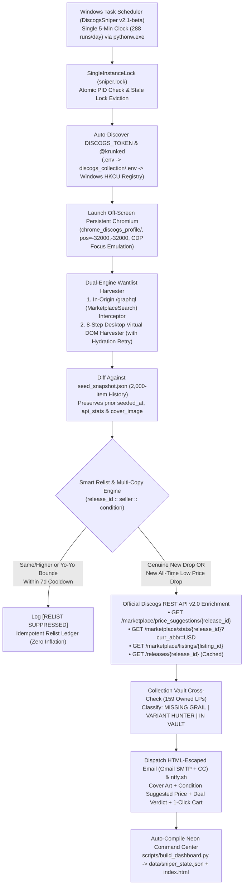

# Discogs Sniper v2.1-beta — Neon Command Center & Hybrid Official Discogs API Engine

> **Outsmart the relist bots. Snipe true Wantlist grails with authentic Discogs API valuation and neon studio telemetry.**  
> A hybrid Python + Official Discogs REST API v2.0 (`https://api.discogs.com`) + Playwright automation engine (`C:\discogs_sniper`) paired with a zero-spinner **Static GitHub Pages Neon Command Center** ([`index.html`](index.html)). Monitors your filtered Discogs Wantlist Marketplace every 5 minutes, intercepts in-origin `/graphql` (`MarketplaceSearch`) payloads alongside the virtualized desktop DOM, eliminates daily auto-relist spam (*"The `recordmule` Slayer"*), cross-references your 159-LP [Discogs Collection Vault (`krunked-fpv/discogs_collection`)](https://github.com/krunked-fpv/discogs_collection), verifies live Wantlist state automatically, and dispatches high-priority HTML alerts with **1-Click Add-to-Cart** links.


---

## What's New in `v2.1.0-beta` (Neon Overdrive + Full Repo Bug Sweep)

### 1. Why the Static Page Previously Showed "19 Overlaps" (Root Cause & Fix)
- **Rolling Archive vs. Live Wantlist:** `seed_snapshot.json` keeps a 2,000-item rolling history (`Nov 6–19`). All 10 exact-owned pressings in the snapshot were historical alerts (`0 of 10` on Live Page 1).
- **Inflated Nav Counter (`10 + 9 = 19 Overlaps`):** The previous badge added `10` historical exact-owned releases and `9` intentional alternate-pressing **Variant Hunter** targets into `"19 Overlaps"`.
- **Disconnected Static Sync:** GitHub Actions never ran a live Wantlist sync, `--prune-owned` never persisted a sync ledger or rebuilt `index.html`, and the browser previously refused to check public Wantlists without a pasted token (while also sending preflight-triggering custom `Accept`/`Authorization` headers).
- **Fixed End-to-End in `v2.1-beta`:**
  - `scripts/build_dashboard.py --sync-wantlist` (enabled in [`.github/workflows/static.yml`](.github/workflows/static.yml)) optionally fetches live Wantlist release IDs at deploy time with graceful offline fallback, and reads `data/wantlist_sync.json` saved by `discogs_sniper.py --api-check` / `--prune-owned`.
  - In the browser, `src/app.js` uses **preflight-free CORS-simple `GET` requests (`?token=`)** to automatically verify your live Wantlist on load (works publicly or with a connected token), clearly separating **Active Live Overlaps** from **Cleared Historical Snapshot** records (collapsed into an archive drawer) and **Variant Hunter Targets**.

### 2. Full Engine, Compiler & UI Bug Sweep
| Layer | Bug Squashed in `v2.1-beta` | Fix |
| :--- | :--- | :--- |
| **Python Engine** (`discogs_sniper.py`) | `build_relist_ledger()` re-incremented `total_relists_seen` across all historical rows on every 5-min save (`seen=528`, `seen=22` for 2-item groups). | Tracks deduplicated `seen_listing_ids` per fingerprint idempotently (`len(seen_ids)`). |
| **Python Engine** | `run_check_on_page()` wrote enriched `api_stats` onto discarded copies, leaving `api_stats: 0` in `seed_snapshot.json`, and `save_seed_listings()` overwrote prior `seeded_at` / covers. | Writes enriched `api_stats`, `cover_image`, and `seller_rating` back onto `current_listings[lid]` and preserves prior enrichment on ongoing Page 1 items. |
| **Python Engine** | `--daemon` mode attached a fresh `page.on("response")` listener on every cycle without removing it (memory leak), and yo-yo price oscillations could re-trigger fake price-drop alerts. | Removes listener in `try ... finally`, compares price drops against `min(last_price, lowest_price)`, escapes HTML in alert emails via `html.escape`, and fixes self-titled album stripping (`The Used`, `The Plot In You`) in `EXTRACT_VISIBLE_DESKTOP_ROWS_JS`. |
| **Static Compiler** (`scripts/build_dashboard.py`) | Dropped top-level `cover_image` (60 recoverable covers) & `allow_offers` (10 listings); fabricated fake `-15.3% STEAL` Mint deals (`price * 1.18` against itself); allowed `recordmule`'s 48 spam relists to skew release medians to `$30.99`. | Recovers **100% of Live Page 1 covers (0 missing)** & `allow_offers`; replaces single-copy inflation with authentic benchmark hierarchy (Official API -> Vault Median -> Per-Seller Deduplicated Median requiring `>= 2` distinct sellers, else `UNRATED`); escapes `</` & `<!--` with RFC 8259 `\u003c` sequences. |
| **Frontend Command Center** (`src/*`) | Browser API calls triggered CORS `OPTIONS` preflights and misreported CORS/429 failures as `Sold (404)`; audio scrubber couldn't seek; Forensics seller table capped at top 20 without Drop-Only controls; `alert()` dialogs blocked UI. | Preflight-free `?token=` `GET` calls; graceful CORS `DELETE` fallback with 1-click CLI command copy; scrubbable 30s studio deck + animated EQ; full searchable 88-seller controls (Drop-Only + Mute); non-blocking neon toasts; capture-phase SVG monogram artwork fallback. |

---

## Forensic Interrogation of `v0.1.0-alpha` — Core Architectural Wins

When we interrogated the production data from `v0.1.0-alpha` (**17,080 log lines** across **5,632 automated runs**, **225 sent email alerts**, and **218 tracked items** in `seed_snapshot.json`), four major architectural flaws emerged:

| # | Forensic Finding from Production Logs (`sniper.log` & `seed_snapshot.json`) | Root Cause in `v0.1.0-alpha` | How `v2.x` Solves It |
| :--- | :--- | :--- | :--- |
| **1** | **The `recordmule` Daily Auto-Relist Spam Bomb (`48.2%` Noise)**<br/>• **99 of 218 tracked items (`45.4%`)** came from a single seller (`recordmule`).<br/>• **90 of 218 items (`41.3%`)** were just *Dayseeker – Dark Sun* (`50x`) and *Creature In The Black Night* (`40x`).<br/>• **31.5% of all alerts (`71/225`)** fired between `12:00–13:59` daily. | Mega-sellers use inventory bots that **delete and re-upload** their entire catalog daily with **new 10-digit Listing IDs** to stay `#1` on *"Listed Newest"*. `v0.1.0-alpha` only checked `item_id not in previous_listings`. | **Semantic Relist Fingerprinting (`release_id::seller::condition`):**<br/>• Collapses same-batch multi-copy drops (`3x copies`) into **1 email**.<br/>• Suppresses same-seller relists within `cooldown_days` (`7d`) at the same/higher price.<br/>• **Price-Drop Override (`PRICE DROP HIT`):** Immediately alerts only when the seller undercuts their true historical low (`-$1.00` or `-3%`)! |
| **2** | **10 Exact Pressings (& 9 Variants) Found in Collection Vault Cross-Check**<br/>• *Silent Planet – Everything Was Sound*, *156/Silence – From A Distance*, *Protest The Hero – Kezia*, *Invent, Animate – Stillworld*, *Currents – The Way It Ends*, *Circa Survive – Juturna*, etc. | When you buy a record on Discogs and add it to your Collection, Discogs **never** auto-removes it from your Wantlist. | **Collection Vault Bridge + Official API Wantlist Pruner:**<br/>• Cross-references `krunked-fpv/discogs_collection` (`159 LPs`) to badge every hit as **`MISSING GRAIL`**, **`VARIANT HUNTER`**, or **`IN VAULT`**.<br/>• Run `python discogs_sniper.py --prune-owned` to remove live overlaps via `DELETE /users/krunked/wants/{release_id}`, persist `data/wantlist_sync.json`, and rebuild `index.html`. |
| **3** | **Zero Official Discogs API Usage + Slow Secondary Browser Tabs**<br/>• Every new hit opened a second Chromium tab (`context.new_page()`), loaded the full release HTML page, and regexed `body.innerText` for overall `Low / Median / High`. | Did not use `https://api.discogs.com` even though `DISCOGS_TOKEN` was already stored in Windows `HKCU\Environment` by `discogs_collection`. | **Official Discogs REST API v2.0 Client (`DiscogsAPIClient`):**<br/>• Auto-discovers `DISCOGS_TOKEN` from `C:\discogs_sniper\.env`, Windows `HKCU\Environment` Registry, or sibling `C:\Discogs_collection\.env`.<br/>• Queries `/marketplace/price_suggestions/{id}` for **condition-graded fair value** (`M`, `NM`, `VG+`), `/marketplace/stats/{id}`, `/marketplace/listings/{id}`, and `/releases/{id}` in pure JSON (**0 extra browser tabs!**). |
| **4** | **Task Scheduler Double-Trigger Bug (`288 -> 576 Runs/Day` on Nov 12)**<br/>• From Nov 8–11, `sniper.log` recorded exactly `288 runs/day` (every 5m).<br/>• On Nov 12, runs doubled to **`576 runs/day`** (`:X2:26` and `:X3:43`, 77s apart) with **40 hydration errors**. | `setup_task.ps1` attached `RepetitionInterval = 5m` to **both** `$RepeatTrigger` (`-At (Get-Date)`) and `$LogonTrigger` (`-AtLogOn`), launching two offset 5-minute clocks. | **Single-Clock `setup_task.ps1` + Atomic `SingleInstanceLock` (`sniper.lock`):**<br/>• `setup_task.ps1` registers a single repeating 5-minute clock (`288 runs/day`).<br/>• `SingleInstanceLock` (`sniper.lock`) prevents overlapping processes from colliding on `chrome_discogs_profile/`. |

---

## System Architecture (`v2.1-beta` Hybrid Pipeline)



---

## Static GitHub Pages Neon Command Center ([`index.html`](index.html))

Compiled from modular source files in [`src/`](src/) (`src/template.html`, `src/styles.css`, `src/app.js`) and [`data/sniper_state.json`](data/sniper_state.json) into a single self-contained, zero-spinner static app with **NEON Telemetry** and **UV Blacklight Overdrive** modes (press `U` to toggle):

### 4 Interactive Tactical Views
1. **Drop Radar (`#view-radar`):**
   * **Scope & Noise Controls:** Toggle between **`All Tracked`** and **`Live Top-25`**, enable **`Relist Shield`** (`218 -> 113` unique offerings), filter by **`Missing Grails`**, **`Verified Deals`**, **`Price Drops`**, **`Make Offer`**, **`Variant Hunter`**, **`In Vault (Hist)`**, independent **`Hide recordmule`**, media grade, and dynamic max-shipped price slider.
   * **Pressing Quick-Inspect Neon Lightbox:** Click any album sleeve/vinyl platter to open a full pressing breakdown with zoomed colored-vinyl SVG disc, market spread telemetry, seller notes, 1-Click Cart, and live Discogs API status check.
   * **Deterministic Colored-Vinyl SVG Platters:** Parses every pressing's `variant` description (`Ultra Clear`, `Pink With Black & White Splatter`, `Half Bone / Half Red Split`, `Black Ice`, `Amber Gold`) into a glossy specular 12-inch SVG disc that slides out on hover, with automatic neon monogram fallbacks if CDN artwork is offline.
   * **Single-Row Tactical Action Rail:** **`Cart ($XX.XX)`**, **`Listing`**, **`30s`** (scrubbable 30-second studio audio preview via iTunes Search API + Deezer JSONP fallback with animated neon EQ visualizer), and **`API`** (preflight-free live verification against `api.discogs.com` with surgical in-place card updates).
2. **Relist Forensics & Seller Radar (`#view-forensics`):**
   * Responsive **24-Hour Alert Distribution** (`12:00–13:59` `recordmule` relist bot window) and **14-Day Task Scheduler Check Histogram** with `288/day` target reference line (`576/day` anomaly highlight on Nov 12).
   * **Full Searchable Seller Leaderboard (all sellers) & Most-Churned Releases:** Full-width tables with zero column clipping plus persistent **`Drop-Only`** and **`Mute`** rules synced straight into `sniper_config.json`.
3. **Collection Vault Bridge (`#view-vault`):**
   * Auto-checks your live Discogs Wantlist on load (no token required for public Wantlists, or authenticated with a connected token) and cleanly separates **Active Live Overlaps** from **Cleared Historical Snapshot** entries (collapsed archive) and **9 Variant Hunter Targets**.
   * Supports 1-click browser `DELETE` when permitted by CORS, plus instant copyable `python discogs_sniper.py --prune-owned` CLI command fallback.
4. **Sniper Rules & Live Discogs API v2.0 Console (`#view-rules`):**
   * Connect your `DISCOGS_TOKEN` locally in `localStorage` (also accessible from the header **Connect API** quick modal), run live `/oauth/identity` and `/marketplace/price_suggestions/{id}` diagnostics, tune cooldown/price-drop/seller rules, and copy or download [`sniper_config.json`](sniper_config.json).

---

## Official Discogs REST API v2.0 Endpoints Used

`discogs_sniper.py` automatically discovers your `DISCOGS_TOKEN` and `DISCOGS_USERNAME` (`krunked`) from:
1. CLI flags (`--token`, `--username`)
2. Process & Windows User/Machine Environment Variables (`DISCOGS_TOKEN`, `DISCOGS_USERNAME` in `HKCU\Environment`)
3. Sibling `C:\Discogs_collection\.env` (and automatically stamps the active token into `C:\discogs_sniper\.env` on startup!)
4. Local `.env` (`C:\discogs_sniper\.env`)

| Endpoint | Method | Purpose in Discogs Sniper v2.1-beta |
| :--- | :---: | :--- |
| `/oauth/identity` | `GET` | Verifies `DISCOGS_TOKEN` and auto-discovers token owner's username (`@krunked`). |
| `/marketplace/price_suggestions/{release_id}` | `GET` | Returns Discogs' official **condition-graded fair market value** (`Mint (M)`, `Near Mint (NM or M-)`, `Very Good Plus (VG+)`, etc.) to compute authentic Deal Delta %. |
| `/marketplace/stats/{release_id}?curr_abbr=USD` | `GET` | Returns live `{ num_for_sale, lowest_price, blocked_from_sale }` in `<150ms` with zero browser tabs. |
| `/marketplace/listings/{listing_id}` | `GET` | Returns structured per-listing JSON: `status` (`For Sale` vs `Sold`), `posted` ISO date, `allow_offers` (`Make Offer`), `seller.stats.rating`, and community `in_wantlist` / `in_collection`. |
| `/releases/{release_id}` | `GET` | Fetches high-res album cover artwork (`images[0].uri`), pressing format metadata, year, country, and community rating (cached in `data/releases_cache.json`). |
| `/users/{username}/wants` | `GET` | Fetches all live Wantlist release IDs (used by `--api-check`, `--prune-owned`, `build_dashboard.py --sync-wantlist`, and automatic browser sync). |
| `/users/{username}/wants/{release_id}` | `DELETE` | Prunes exact pressings you already own in your Collection Vault from your live Discogs Wantlist (`--prune-owned`). |

---

## Repository Structure (`C:\discogs_sniper`)

```text
discogs_sniper/
├── .github/
│   └── workflows/
│       └── static.yml                     # Builds (--sync-wantlist) & deploys Neon Command Center to GitHub Pages
├── data/
│   ├── log_forensics.json                 # Parsed telemetry from 5,632 checks & 225 alerts in sniper.log
│   ├── sniper_state.json                  # Compiled v2.1.0-beta dataset, relist groups & authentic market benchmarks
│   ├── vault_crossref.json                # 159-LP Collection Vault cross-reference & Discogs CDN covers
│   └── wantlist_sync.json                 # (Optional/auto-generated) Verified live Wantlist snapshot from API sync
├── scripts/
│   └── build_dashboard.py                 # Fast offline/hybrid compiler: data/* + src/* -> index.html (<0.15s)
├── src/
│   ├── template.html                      # Modular HTML5 shell, KPI ribbon, 4 tactical views & neon modals
│   ├── styles.css                         # Vanilla CSS Neon Telemetry + UV Blacklight Overdrive design system
│   └── app.js                             # Drop Radar, Quick-Inspect lightbox, SVG vinyl, scrubbable audio & API client
├── tests/
│   └── test_sniper_v2.py                  # 15 unit tests for engine, deduplication, live sync, escaping & HTML build
├── discogs_sniper.py                      # Core v2.1-beta Hybrid API + GraphQL + Playwright sniper engine
├── sniper_config.json                     # Declarative relist cooldown, price-drop override & seller rules
├── seed_snapshot.json                     # Unified 2,000-item rolling state snapshot + idempotent relist_ledger
├── index.html                             # Compiled self-contained GitHub Pages Neon Command Center
├── favicon.svg / favicon.ico / *.png      # Neon cyan/magenta vinyl crosshair icon suite
├── setup_task.ps1                         # Windows Task Scheduler installer (C:\discogs_sniper, 288 runs/day)
├── run_sniper.ps1                         # Foreground PowerShell console loop (C:\discogs_sniper)
├── requirements.txt                       # Python dependencies (playwright, requests)
└── .env                                   # Active environment config (auto-hydrates $env:DISCOGS_TOKEN)
```

---

## CLI Reference & Operational Modes

| Command | Behavior |
| :--- | :--- |
| `python discogs_sniper.py` | **Standard v2.1-beta Delta Run** (executed every 5 mins by Task Scheduler). Acquires `sniper.lock`, harvests Wantlist via in-origin GraphQL + Desktop Virtual DOM, filters auto-relist spam via idempotent `relist_ledger`, enriches actionable hits via Official Discogs API v2.0 + Collection Vault Bridge, sends HTML-escaped alerts, and rebuilds `index.html`. |
| `python discogs_sniper.py --api-check` | **Official Discogs API & Live Vault Diagnostics** (zero browser needed). Verifies `DISCOGS_TOKEN` against `/oauth/identity`, persists `data/wantlist_sync.json`, and reports live vs. historical Vault overlaps. |
| `python discogs_sniper.py --prune-owned --dry-run` | **Preview Live Wantlist Cleanup.** Lists exact-owned Collection Vault pressings currently present on your live Discogs Wantlist. |
| `python discogs_sniper.py --prune-owned` | **Execute Live Wantlist Cleanup.** Calls `DELETE /users/krunked/wants/{release_id}`, verifies 0 remaining overlaps, saves `data/wantlist_sync.json`, and automatically rebuilds `index.html`. |
| `python scripts/build_dashboard.py --sync-wantlist` | **Compile Command Center with Live Wantlist Verification.** Optionally fetches live Wantlist IDs (gracefully falls back offline) before compiling `data/sniper_state.json` and `index.html`. |
| `python discogs_sniper.py --build-ui` | **Compile Static Command Center.** Runs `scripts/build_dashboard.py` to compile `data/sniper_state.json` and `index.html` in `<0.15s`. |
| `python discogs_sniper.py --login` | **Interactive Login Bootstrap.** Opens `WANTLIST_URL` in the persistent Chromium profile and waits for `ENTER`. |
| `python discogs_sniper.py --reseed` | **Force Baseline Reseed.** Captures the current 25 listings into `seed_snapshot.json` + `relist_ledger` without sending alerts. |
| `python discogs_sniper.py --test` | **End-to-End Alert Test.** Dispatches a live HTML email + `ntfy.sh` alert (with Discogs API price suggestions, cover art, and Vault status) for the `#1` top listing. |
| `python discogs_sniper.py --daemon` | **Continuous In-Process Daemon.** Polls continuously with a randomized `45–75s` jitter interval (leak-free response listener cleanup). |
| `.\setup_task.ps1` | **Register Fixed 5-Minute Scheduled Task.** Registers `DiscogsSniper` in Windows Task Scheduler with a single 5-minute repeating trigger (`288 runs/day`). |
