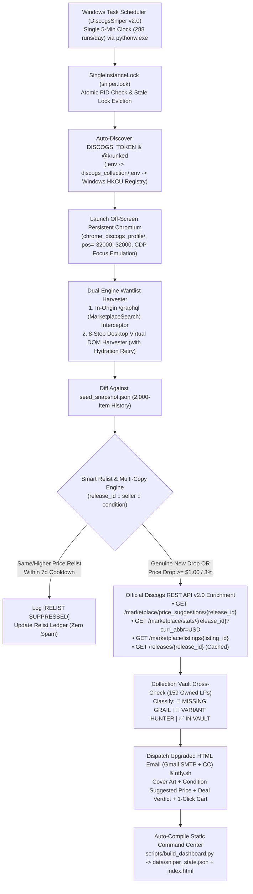

# 🎯 Discogs Sniper v2.0 — Hybrid Official Discogs API + GraphQL + Static Command Center

> **Outsmart the relist bots. Snipe true Wantlist grails with condition-matched Discogs API valuation.**  
> A hybrid Python + Official Discogs REST API v2.0 (`https://api.discogs.com`) + Playwright automation engine (`C:\DiscogsSniper`) paired with a zero-spinner **Static GitHub Pages Command Center** ([`index.html`](index.html)). Monitors your filtered Discogs Wantlist Marketplace every 5 minutes, intercepts in-origin `/graphql` (`MarketplaceSearch`) payloads alongside the virtualized desktop DOM, eliminates daily auto-relist spam (*"The `recordmule` Slayer"*), cross-references your 159-LP [Discogs Collection Vault (`krunked-fpv/discogs_collection`)](https://github.com/krunked-fpv/discogs_collection), enriches hits via the official Discogs API with **zero extra browser tabs**, and dispatches high-priority HTML alerts with **1-Click Add-to-Cart** links.


---

## 🔍 Forensic Interrogation of `v0.1.0-alpha` — What We Uncovered & Fixed in `v2.0`

When we interrogated the production data from `v0.1.0-alpha` (**17,080 log lines** across **5,632 automated runs**, **225 sent email alerts**, and **218 tracked items** in `seed_snapshot.json`), four major architectural flaws emerged:

| # | Forensic Finding from Production Logs (`sniper.log` & `seed_snapshot.json`) | Root Cause in `v0.1.0-alpha` | How `v2.0` Solves It |
| :--- | :--- | :--- | :--- |
| **1** | **The `recordmule` Daily Auto-Relist Spam Bomb (`48.2%` Noise)**<br/>• **99 of 218 tracked items (`45.4%`)** came from a single seller (`recordmule`).<br/>• **90 of 218 items (`41.3%`)** were just *Dayseeker – Dark Sun* (`50x`) and *Creature In The Black Night* (`40x`).<br/>• **31.5% of all alerts (`71/225`)** fired between `12:00–13:59` daily. | Mega-sellers use inventory bots that **delete and re-upload** their entire catalog daily with **new 10-digit Listing IDs** to stay `#1` on *"Listed Newest"*. `v0.1.0-alpha` only checked `item_id not in previous_listings`. | **Semantic Relist Fingerprinting (`release_id::seller::condition`):**<br/>• Collapses same-batch multi-copy drops (`3x copies`) into **1 email**.<br/>• Suppresses same-seller relists within `cooldown_days` (`7d`) at the same/higher price.<br/>• **Price-Drop Override (`📉 PRICE DROP HIT`):** Immediately alerts if the seller relists at a lower price (`-$1.00` or `-3%`)! |
| **2** | **10 Exact Pressings (& 9 Variants) Still Firing Alerts Were Already in Your Collection Vault!**<br/>• *Silent Planet – Everything Was Sound*, *156/Silence – From A Distance*, *Protest The Hero – Kezia*, *Invent, Animate – Stillworld*, *Currents – The Way It Ends*, *Circa Survive – Juturna*, etc. | When you buy a record on Discogs and add it to your Collection, Discogs **never** auto-removes it from your Wantlist. | **Collection Vault Bridge + Official API Wantlist Pruner:**<br/>• Cross-references `krunked-fpv/discogs_collection` (`159 LPs`) to badge every hit as **`🎯 MISSING GRAIL`**, **`🌈 VARIANT HUNTER`**, or **`✅ ALREADY IN VAULT`**.<br/>• Run `python discogs_sniper.py --prune-owned` (or click **🗑️ Remove from Wantlist** in the web UI) to call `DELETE /users/krunked/wants/{release_id}`! |
| **3** | **Zero Official Discogs API Usage + Slow Secondary Browser Tabs**<br/>• Every new hit opened a second Chromium tab (`context.new_page()`), loaded the full release HTML page, and regexed `body.innerText` for overall `Low / Median / High`. | Did not use `https://api.discogs.com` even though `DISCOGS_TOKEN` was already stored in Windows `HKCU\Environment` by `discogs_collection`. | **Official Discogs REST API v2.0 Client (`DiscogsAPIClient`):**<br/>• Auto-discovers `DISCOGS_TOKEN` from `.env`, `C:\DiscogsCollection\discogs_collection\.env`, or Windows `HKCU\Environment` Registry.<br/>• Queries `/marketplace/price_suggestions/{id}` for **condition-graded fair value** (`M`, `NM`, `VG+`), `/marketplace/stats/{id}`, `/marketplace/listings/{id}`, and `/releases/{id}` in pure JSON (**0 extra browser tabs!**). |
| **4** | **Task Scheduler Double-Trigger Bug (`288 → 576 Runs/Day` on Nov 12)**<br/>• From Nov 8–11, `sniper.log` recorded exactly `288 runs/day` (every 5m).<br/>• On Nov 12, runs doubled to **`576 runs/day`** (`:X2:26` and `:X3:43`, 77s apart) with **40 hydration errors**. | `setup_task.ps1` attached `RepetitionInterval = 5m` to **both** `$RepeatTrigger` (`-At (Get-Date)`) and `$LogonTrigger` (`-AtLogOn`), launching two offset 5-minute clocks. | **Single-Clock `setup_task.ps1` + Atomic `SingleInstanceLock` (`sniper.lock`):**<br/>• `setup_task.ps1` now registers a single repeating 5-minute clock (`288 runs/day`).<br/>• `SingleInstanceLock` (`sniper.lock`) prevents overlapping processes from colliding on `chrome_discogs_profile/`. |

---

## 🏗️ System Architecture (`v2.0` Hybrid Pipeline)



---

## 🌐 Static GitHub Pages Command Center ([`index.html`](index.html))

Just like [`krunked-fpv/discogs_collection`](https://github.com/krunked-fpv/discogs_collection), Discogs Sniper v2.0 compiles a self-contained, zero-spinner **Static GitHub Pages Command Center** (`index.html`) from modular source files in [`src/`](src/) (`src/template.html`, `src/styles.css`, `src/app.js`) and [`data/sniper_state.json`](data/sniper_state.json):

### 4 Interactive Tactical Views
1. **🎯 Live Drop Radar (`#view-radar`):**
   * **One-Click `🧹 Collapse Auto-Relists` Toggle (ON by default):** Instantly condenses `218` raw tracked listings into `113` unique active offerings (eliminating `105` duplicate auto-relists), with expandable **Relist Audit Trail drawers** showing every historical listing ID, price, and alert timestamp.
   * **Deterministic Colored-Vinyl SVG Platters:** Parses every pressing's `variant` description (`Ultra Clear`, `Pink With Black & White Splatter`, `Half Bone / Half Red Split`, `Black Ice`, `Amber Gold`) into an animated SVG 12-inch vinyl disc that slides out from behind the album sleeve on hover.
   * **1-Click Action Bar:** Direct **`🛒 1-Click Cart`**, **`🔎 Listing`**, **`🎧 30s`** (real 30-second studio audio preview via iTunes Search API with automatic Deezer JSONP fallback), and **`⚡ Live API`** (queries `https://api.discogs.com/marketplace/listings/{id}`, `/marketplace/stats/{id}`, and `/marketplace/price_suggestions/{id}` live in your browser to verify whether the record is still `🟢 FOR SALE` or `🔴 SOLD`).
2. **🧹 Relist Forensics & Seller Radar (`#view-forensics`):**
   * Visualizes the **24-Hour Alert Distribution** (`12:00–13:59` `recordmule` relist bot window) and the **14-Day Task Scheduler Check Histogram** (`288 → 576 runs/day` anomaly on Nov 12).
   * **Interactive Seller Volume Leaderboard & Churn Table:** Rank all 46 sellers on your Wantlist by relist rate and click **`🔇 Mute Seller`** to silence any spam seller immediately.
3. **🏛️ Collection Vault Cross-Check (`#view-vault`):**
   * Lists the **10 Exact Owned Pressings** and **9 Variant Upgrade Candidates** found by cross-referencing your 159-LP Collection Vault.
   * Click **`🗑️ Remove from Wantlist`** (or **Prune All 10 Owned Pressings**) to execute `DELETE https://api.discogs.com/users/krunked/wants/{release_id}` directly from the browser!
4. **⚙️ Sniper Rules & Live Discogs API v2.0 Console (`#view-rules`):**
   * Connect your `DISCOGS_TOKEN` in the browser (persisted in `localStorage` and compatible with `krunked-fpv.github.io/discogs_collection`), test `/oauth/identity` and `/marketplace/price_suggestions/{id}` live, customize your sniper rules, and export [`sniper_config.json`](sniper_config.json).

---

## ⚡ Official Discogs REST API v2.0 Endpoints Used

`discogs_sniper.py` automatically discovers your `DISCOGS_TOKEN` and `DISCOGS_USERNAME` (`krunked`) from:
1. CLI flags (`--token`, `--username`)
2. Environment variables (`DISCOGS_TOKEN`, `DISCOGS_USERNAME`)
3. Local `.env` (`C:\DiscogsSniper\.env`) or sibling `C:\DiscogsCollection\discogs_collection\.env`
4. Windows User Environment Registry (`HKCU\Environment` via `winreg`, where `discogs_collection` stored it!)

| Endpoint | Method | Purpose in Discogs Sniper v2.0 |
| :--- | :---: | :--- |
| `/oauth/identity` | `GET` | Verifies `DISCOGS_TOKEN` and auto-discovers token owner's username (`@krunked`). |
| `/marketplace/price_suggestions/{release_id}` | `GET` | Returns Discogs' official **condition-graded fair market value** (`Mint (M)`, `Near Mint (NM or M-)`, `Very Good Plus (VG+)`, etc.) to compute exact Deal Delta %! |
| `/marketplace/stats/{release_id}?curr_abbr=USD` | `GET` | Returns live `{ num_for_sale, lowest_price, blocked_from_sale }` in `<150ms` with zero browser tabs. |
| `/marketplace/listings/{listing_id}` | `GET` | Returns structured per-listing JSON: `status` (`For Sale` vs `Sold`), `posted` ISO date, `allow_offers` (`Make Offer`), `seller.stats.rating`, and community `in_wantlist` / `in_collection`. |
| `/releases/{release_id}` | `GET` | Fetches high-res album cover artwork (`images[0].uri`), pressing format metadata, year, country, and community rating (cached in `data/releases_cache.json`). |
| `/users/{username}/wants` | `GET` | Fetches all release IDs currently on your Discogs Wantlist for Vault overlap auditing. |
| `/users/{username}/wants/{release_id}` | `DELETE` | Prunes exact pressings you already own in your Collection Vault from your Discogs Wantlist (`--prune-owned`). |

---

## 📂 Repository Structure

```text
discogs_sniper/
├── .github/
│   └── workflows/
│       └── static.yml                     # Builds & deploys Static Command Center to GitHub Pages
├── data/
│   ├── log_forensics.json                 # Parsed telemetry from 5,632 checks & 225 alerts in sniper.log
│   ├── sniper_state.json                  # Compiled 218-listing dataset, relist groups & deal scores
│   └── vault_crossref.json                # 159-LP Collection Vault cross-reference & Discogs CDN covers
├── scripts/
│   └── build_dashboard.py                 # Fast offline compiler: data/* + src/* -> index.html (<0.15s)
├── src/
│   ├── template.html                      # Modular HTML5 shell, KPI ribbon & 4 tactical views
│   ├── styles.css                         # Vanilla CSS dark-obsidian studio mastering design system
│   └── app.js                             # Interactive Drop Radar, SVG vinyl renderer, 30s audio & live API client
├── tests/
│   └── test_sniper_v2.py                  # Unit tests for relist deduplication, price drops, wax parser & HTML build
├── discogs_sniper.py                      # Core v2.0 Hybrid API + GraphQL + Playwright sniper engine
├── sniper_config.json                     # Declarative v2.0 relist cooldown, price-drop override & seller rules
├── seed_snapshot.json                     # Unified 2,000-item rolling state snapshot + relist_ledger
├── index.html                             # Compiled self-contained GitHub Pages Command Center
├── setup_task.ps1                         # Windows Task Scheduler installer (single 5-min clock = 288 runs/day)
├── run_sniper.ps1                         # Foreground PowerShell console loop
├── requirements.txt                       # Python dependencies (playwright, requests)
└── .env.example                           # Template for local .env configuration
```

---

## 🛠️ CLI Reference & Operational Modes

| Command | Behavior |
| :--- | :--- |
| `python discogs_sniper.py` | **Standard v2.0 Delta Run** (executed every 5 mins by Task Scheduler). Acquires `sniper.lock`, harvests Wantlist via in-origin GraphQL + Desktop Virtual DOM, filters auto-relist spam via `relist_ledger`, enriches actionable hits via Official Discogs API v2.0 + Collection Vault Bridge, sends alerts, and rebuilds `index.html`. |
| `python discogs_sniper.py --api-check` | **Official Discogs API & Vault Diagnostics** (Zero browser needed). Verifies `DISCOGS_TOKEN` against `/oauth/identity`, displays rate limit remaining, and lists all exact-owned Collection Vault pressings still on your Wantlist. |
| `python discogs_sniper.py --prune-owned --dry-run` | **Preview Wantlist Cleanup.** Lists the 10 exact pressings you already own in your Collection Vault that would be removed from your Discogs Wantlist. |
| `python discogs_sniper.py --prune-owned` | **Execute Wantlist Cleanup.** Calls `DELETE /users/krunked/wants/{release_id}` to remove already-owned exact pressings from your Discogs Wantlist. |
| `python discogs_sniper.py --build-ui` | **Compile Static Command Center.** Runs `scripts/build_dashboard.py` to compile `data/sniper_state.json` and `index.html` in `<0.15s`. |
| `python discogs_sniper.py --login` | **Interactive Login Bootstrap.** Opens `WANTLIST_URL` in the persistent Chromium profile and waits for `ENTER`. |
| `python discogs_sniper.py --reseed` | **Force Baseline Reseed.** Captures the current 25 listings into `seed_snapshot.json` + `relist_ledger` without sending alerts. |
| `python discogs_sniper.py --test` | **End-to-End Alert Test.** Dispatches a live v2.0 HTML email + `ntfy.sh` alert (with Discogs API price suggestions, cover art, and Vault status) for the `#1` top listing. |
| `python discogs_sniper.py --daemon` | **Continuous In-Process Daemon.** Polls continuously with a randomized `45–75s` jitter interval. |
| `.\setup_task.ps1` | **Register Fixed 5-Minute Scheduled Task.** Registers `DiscogsSniper` in Windows Task Scheduler with a single 5-minute repeating trigger (`288 runs/day`). |
