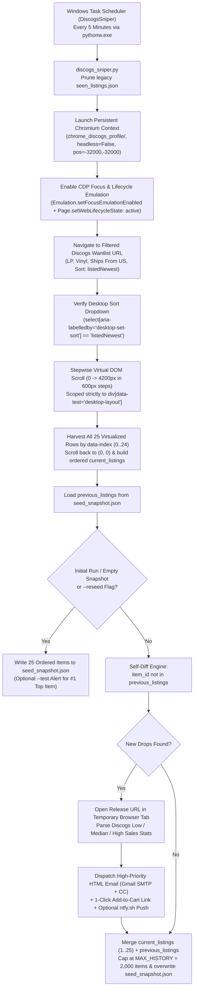

# 🎯 Discogs Sniper — Alpha Build (`v0.1.0-alpha`)

> **Snipe Discogs Wantlist vinyl drops from the bots!**  
> A local Python + Playwright automation tool (`C:\DiscogsSniper`) that monitors your filtered Discogs Wantlist Marketplace every 5 minutes, harvests React-virtualized desktop listings from an off-screen persistent Chromium session, diffs against a 2,000-item rolling state snapshot, enriches hits with live release sales statistics (`Low / Median / High`), and dispatches high-priority HTML alerts with **1-Click Add-to-Cart** links via Gmail SMTP and `ntfy.sh`.


-6f42c1?style=for-the-badge)

---

## ✨ What's New

### **Nov 2026 — Alpha Build (`v0.1.0-alpha`)**
* **Inaugural Vibe-Coded Release:** Our very first vibe-coded program built together — battle-tested in production with **5,600+ automated 5-minute checks** and **225+ real-time vinyl drop alerts** dispatched.
* **Cloudflare-Safe Off-Screen Persistent Browser:** Uses a persistent Playwright Chromium profile (`chrome_discogs_profile/`) launched with `headless=False` at `--window-position=-32000,-32000` and Chrome DevTools Protocol (CDP) focus emulation (`Emulation.setFocusEmulationEnabled` & `Page.setWebLifecycleState: active`) to avoid headless bot detection without stealing Windows desktop focus.
* **React Virtualized Desktop DOM Harvester:** Strictly scopes queries to `div[data-test="desktop-layout"]` (ignoring the hidden `div[data-test="mobile-layout"]` at `top: 0`), enforces `listedNewest` sort order, and scrolls in `600px` steps (`0..4200px`) to mount and capture all 25 virtualized rows (`data-index="0..24"`).
* **Unified Self-Diff Engine (`seed_snapshot.json`):** Automatically prunes deprecated `seen_listings.json` on startup, compares live Page-1 listings against a rolling 2,000-item history so older listings shifting onto Page 1 after a sale never trigger false-positive alerts, and preserves exact `1..25` top-of-page rank order.
* **Live Release Sales Stats & 1-Click Cart Alerts:** Fetches release `Low / Median / High` marketplace stats in-browser on hit detection and dispatches `Importance: High` UTF-8 HTML emails (Primary + CC) featuring direct **VIEW LISTING** and **1-CLICK ADD TO CART** (`/sell/cart/?add=<ID>`) buttons, plus optional `ntfy.sh` urgent push notifications.
* **Zero-Popup Windows Task Scheduler Automation (`setup_task.ps1`):** Configures `DiscogsSniper` in Windows Task Scheduler using `pythonw.exe` to run silently every 5 minutes in the background.

---

## 🏗️ System Architecture & 5-Minute Execution Pipeline



---

## 🧠 Technical Deep Dives

### 1. Target Wantlist Query
By default, `discogs_sniper.py` monitors the modern Discogs Marketplace Wantlist endpoint filtered for **LP Vinyl** shipping from the **United States**, sorted by **Listed Newest**:

```text
https://www.discogs.com/shop/mywants/?formatDescription=LP&formatName=Vinyl&shipsFrom=United+States&sort=listedNewest
```

---

### 2. Runtime Environment, Scheduling & Anti-Bot Strategy
* **OS & Toolchain:** Windows 11 running 64-bit Python 3.12 and Playwright Chromium inside `C:\DiscogsSniper`.
* **Silent Background Scheduling (`setup_task.ps1`):**
  * Registers a Windows Scheduled Task named `DiscogsSniper` that executes `pythonw.exe` (windowless Python) every 5 minutes indefinitely, triggered both immediately and at Windows logon.
  * Configured with `-AllowStartIfOnBatteries`, `-DontStopIfGoingOnBatteries`, `-StartWhenAvailable`, `-MultipleInstances IgnoreNew` (preventing overlapping runs), and a 3-minute `-ExecutionTimeLimit` safety cutoff.
* **Authentication & Cloudflare Evasion:**
  * **Persistent Profile (`chrome_discogs_profile/`):** Retains your logged-in Discogs session cookies and Cloudflare clearance tokens across 5-minute runs.
  * **Off-Screen Non-Headless Chromium:** Launches with `headless=False` positioned off-screen (`--window-position=-32000,-32000`) and `--disable-blink-features=AutomationControlled`. Running a real browser context avoids headless fingerprinting while keeping your taskbar and screen free of popup windows.
  * **Anti-Throttling & CDP Focus Emulation:** Passes `--disable-background-timer-throttling`, `--disable-backgrounding-occluded-windows`, and `--disable-renderer-backgrounding`, then opens a Chrome DevTools Protocol (CDP) session on the page:
    ```python
    cdp = context.new_cdp_session(page)
    cdp.send("Emulation.setFocusEmulationEnabled", {"enabled": True})
    cdp.send("Page.setWebLifecycleState", {"state": "active"})
    ```
    This forces Chromium to treat the off-screen window as actively focused so React's virtualized list mounts and hydrates immediately.

---

### 3. Page DOM & React Virtualization Handling
Discogs' redesigned `/shop/mywants/` marketplace is a **React virtualized list**:
* **No Legacy `[data-itemid]` Attributes:** Items no longer render static `[data-itemid]` nodes. Instead, rows are mounted dynamically inside:
  ```html
  <div data-test="desktop-layout">
    <div data-index="0">
      <div data-test="list-item-desktop">...</div>
    </div>
    ...
  </div>
  ```
* **Strict Desktop Layout Scoping:** The page DOM simultaneously includes a hidden `<div data-test="mobile-layout">` whose child elements sit at `top: 0` coordinates. All DOM queries inside `EXTRACT_VISIBLE_DESKTOP_ROWS_JS` and `ensure_sorted_newest()` scope strictly to `div[data-test="desktop-layout"]` to prevent mobile DOM nodes from contaminating row indices.
* **Stepwise Virtual Scroll Harvesting (`extract_seed_listings`):**
  1. Verifies the desktop sort `<select aria-labelledby="desktop-set-sort">` is set to `"listedNewest"` (automatically switching and waiting `2000ms` if Discogs reset the sort state).
  2. Scrolls down the page in 8 steps: `0`, `600`, `1200`, `1800`, `2400`, `3000`, `3600`, and `4200` px (pausing `250ms` per step).
  3. At each scroll stop, evaluates `EXTRACT_VISIBLE_DESKTOP_ROWS_JS` to harvest currently mounted rows into a dictionary keyed by integer `data-index` (`0..24`).
  4. Scrolls back to `(0, 0)` and sorts all harvested rows strictly by `data-index` (`rank = data_index + 1`).
* **Multi-Fallback Listing ID & Metadata Extraction:**
  * Parses the 10-digit Listing ID from item links (`/shop/item/<ID>` or `/sell/item/<ID>`) or fallback Add-to-Cart links (`/sell/cart/?add=<ID>`).
  * Extracts **Artist + Title**, **Pressing Variant**, **List Price**, **Total Shipped Price**, **Media & Sleeve Condition badges** (`span[class*="bg-condition-"] p`), **Seller Username**, **Listed Age** (`button[data-slot="tooltip-trigger"]`), **Release URL** (`/release/<ID>`), and **Seller Notes**.

---

### 4. State & Self-Diff Engine (`seed_snapshot.json`)
* **Unified Persistence File:** All state is stored in `seed_snapshot.json`. Legacy `seen_listings.json` is deprecated and automatically removed on startup via `cleanup_legacy_files()`.
* **Initial Seed / Forced Reseed (`--reseed`):**
  * When `seed_snapshot.json` is missing or empty (or `--reseed` is passed), the script captures all 25 rows in exact `0..24` rank order (`rank` `1..25`), writes them to `seed_snapshot.json`, and exits without spamming alerts.
* **Delta Runs & Page-1 Shift Protection:**
  1. Extracts the 25 live Page-1 listings (`current_listings`).
  2. Loads `previous_listings` from `seed_snapshot.json`.
  3. Computes new hits: `diff_hits = [item for item_id, item in current_listings.items() if item_id not in previous_listings]`.
  4. Iterates through `reversed(diff_hits)` (so multiple simultaneous drops alert in chronological oldest-to-newest order), fetches release sales stats, and dispatches alerts.
  5. **Rolling 2,000-Item Merge (`save_seed_listings`):** Writes `current_listings` first (preserving exact `1..25` Page-1 rank order), followed by all previously seen items from `previous_listings` up to `MAX_HISTORY = 2000`. Because up to 2,000 historical listing IDs are retained, an older listing that shifts from Page 2 back onto Page 1 after another record sells or is removed will **never** trigger a false-positive alert.

#### Example `seed_snapshot.json` Structure
```json
{
  "updated_at": "2026-11-19T19:53:47",
  "live_page_count": 25,
  "total_tracked": 218,
  "items": {
    "4498617398": {
      "rank": 1,
      "id": "4498617398",
      "title": "Dayseeker - Dark Sun",
      "variant": "Stereo, Album, Limited Edition, Repress, LP, Ultra Clear",
      "media_condition": "M",
      "sleeve_condition": "NM",
      "list_price": "$30.99",
      "total_price": "$38.49",
      "seller_info": "recordmule",
      "listed_age": "Listed 6 hours ago",
      "item_url": "https://www.discogs.com/sell/item/4498617398",
      "add_to_cart_url": "https://www.discogs.com/sell/cart/?add=4498617398",
      "release_url": "https://www.discogs.com/release/38857860",
      "raw_description": "Brand new in the original factory packaging...",
      "seeded_at": "2026-11-19T19:53:47"
    }
  }
}
```

---

### 5. High-Priority Alerting Pipeline
* **In-Browser Release Statistics (`fetch_release_stats_in_browser`):**
  * Whenever a new hit is detected (or `--test` is run), the scraper opens `release_url` in a temporary browser tab (`context.new_page()`) and parses the release's historical **Low**, **Median**, and **High** sold prices so you can immediately evaluate whether the listing price is a deal.
* **Gmail SMTP Delivery (`smtp.gmail.com:465`):**
  * **Primary Recipient (`To` / `From`):** `alexgoresch@gmail.com`
  * **CC Recipient (`Cc` header & SMTP envelope `recipients`):** `mleven42@gmail.com`
  * **Urgent Priority Headers:** `Importance: High`, `X-Priority: 1`, `X-MSMail-Priority: High`, `Priority: urgent`
  * **Mojibake-Proof Encoding:** Rendered as clean UTF-8 HTML with pure ASCII labels (`NEW HIT * <Title> (<Total Price>)`) to avoid character encoding corruption across Windows PowerShell edits.
* **Email Payload Breakdown:**
  * **Header:** Artist & Album Title, Pressing Variant, and 10-digit Listing ID (`#<ID>`).
  * **Action Buttons:**
    * 🔵 **VIEW LISTING (`#<ID>`)** → `https://www.discogs.com/sell/item/<ID>`
    * 🟢 **1-CLICK ADD TO CART (`$<Total>`)** → `https://www.discogs.com/sell/cart/?add=<ID>`
  * **Comparison Table:**
    * **List / Total Shipped:** e.g., `$30.99 ($38.49 total)`
    * **Discogs Low / Median / High:** e.g., `$24.99 / $42.00 / $75.00`
    * **Condition:** `Media: M | Sleeve: NM`
    * **Seller & Age:** Seller username + relative listing timestamp (`Listed 3 minutes ago`)
    * **Direct Listing URL & Release Page URL**
    * **Seller Notes:** Full unedited seller item description.
* **Optional `ntfy.sh` Push Notifications:**
  * If the `NTFY_TOPIC` environment variable is set, `send_alerts()` also dispatches an urgent mobile/desktop push notification to `https://ntfy.sh/<NTFY_TOPIC>` with click-through directly to the listing URL.

---

## 📂 Codebase Components

| File / Directory | Purpose |
| :--- | :--- |
| [`discogs_sniper.py`](discogs_sniper.py) | Core Playwright scraper, virtualized DOM harvester, self-diff delta engine, release stats fetcher, and Gmail SMTP / `ntfy.sh` alerting pipeline. Supports `--login`, `--reseed`, `--test`, and `--daemon`. |
| [`seed_snapshot.json`](seed_snapshot.json) | Unified JSON state snapshot storing the 25 current Page-1 listings in rank order plus up to 2,000 historical listings for page-shift deduplication. |
| [`setup_task.ps1`](setup_task.ps1) | Administrative PowerShell script that locates `pythonw.exe`, ensures off-screen Chromium positioning (`--window-position=-32000,-32000`), and registers the `DiscogsSniper` Windows Scheduled Task (every 5 minutes). |
| [`run_sniper.ps1`](run_sniper.ps1) | Interactive PowerShell wrapper loop that runs `python discogs_sniper.py` every 300 seconds in a visible console window for live monitoring or debugging. |
| [`sniper.log`](sniper.log) | Append-only UTF-8 runtime log recording every 5-minute check, top-3 parsed listings, delta counts, and sent alert audit trails. |
| `chrome_discogs_profile/` | Persistent Chromium user-data directory storing active Discogs authentication cookies and Cloudflare clearance state. |

---

## 🚀 Installation, Setup & Operations

### Prerequisites
* **OS:** Windows 11 (`C:\DiscogsSniper`)
* **Python:** 64-bit Python 3.12+
* **Dependencies:**
  ```powershell
  pip install playwright requests
  playwright install chromium
  ```

### Step 1: Authenticate Your Persistent Browser Session
Run `--login` once to open the persistent Chromium profile, sign in to Discogs (and pass any initial verification), confirm your Wantlist is visible and sorted by **Listed Newest**, then press `ENTER` in the terminal:
```powershell
python discogs_sniper.py --login
```

### Step 2: Seed the Baseline Snapshot & Send a Test Alert
Generate a fresh `seed_snapshot.json` baseline from the current 25 newest listings and verify your Gmail SMTP / `ntfy.sh` pipeline by firing a test alert for the `#1` newest listing:
```powershell
python discogs_sniper.py --reseed --test
```

### Step 3: Register the 5-Minute Background Scheduled Task
Run `setup_task.ps1` in PowerShell to register the windowless `pythonw.exe` task in Windows Task Scheduler:
```powershell
.\setup_task.ps1
```

---

## 🛠️ CLI Reference & Operational Modes

| Command | Behavior |
| :--- | :--- |
| `python discogs_sniper.py` | **Standard Delta Run** (executed every 5 mins by Task Scheduler). Harvests the 25 newest desktop listings, diffs against `seed_snapshot.json`, sends alerts for any new listing IDs, and updates `seed_snapshot.json`. |
| `python discogs_sniper.py --login` | **Interactive Login Bootstrap.** Opens `WANTLIST_URL` in the persistent Chromium profile and waits for `ENTER` so session cookies are saved cleanly. |
| `python discogs_sniper.py --reseed` | **Force Baseline Reseed.** Captures the current 25 listings into `seed_snapshot.json` in `1..25` rank order without sending new-drop alerts. |
| `python discogs_sniper.py --test` | **End-to-End Alert Test.** Runs a check (or reseed) and dispatches a live email + `ntfy.sh` alert (including release `Low / Median / High` stats) for the `#1` top listing on your Wantlist. |
| `python discogs_sniper.py --daemon` | **Continuous In-Process Daemon.** Keeps the browser context open and polls continuously with a randomized `45–75s` jitter interval. |
| `.\run_sniper.ps1` | **Foreground Console Loop.** Runs `python discogs_sniper.py` every 300 seconds with timestamped console output. |

### Environment Variables
| Variable | Default | Description |
| :--- | :--- | :--- |
| `GMAIL_APP_PASSWORD` | Configured fallback in `discogs_sniper.py` | 16-character Google App Password used for `smtp.gmail.com:465` authentication. |
| `NTFY_TOPIC` | `""` (disabled) | Optional `ntfy.sh` topic name for urgent mobile/desktop push notifications. |

---

## 🗺️ Roadmap (Alpha → Beta)
- [ ] **Externalized Configuration (`.env` / `config.json`):** Move email recipients, SMTP credentials, and custom Wantlist filter URLs into an untracked `.env` file and exclude `chrome_discogs_profile/` & runtime logs via `.gitignore`.
- [ ] **Smart Deal Scoring & Price Ceilings:** Highlight or filter drops priced below the release's historical Discogs `Median` (or within a configurable percentage threshold) and minimum Media/Sleeve condition (e.g., `VG+` / `NM` only).
- [ ] **Multi-Page Deep Sweeps:** Optional pagination support (`page=2..N`) for large Wantlist batch drops.
- [ ] **Rich Cover Art & Dashboard Integration:** Embed release cover thumbnails in HTML email alerts and connect drop history to the Discogs Collection Vault.
